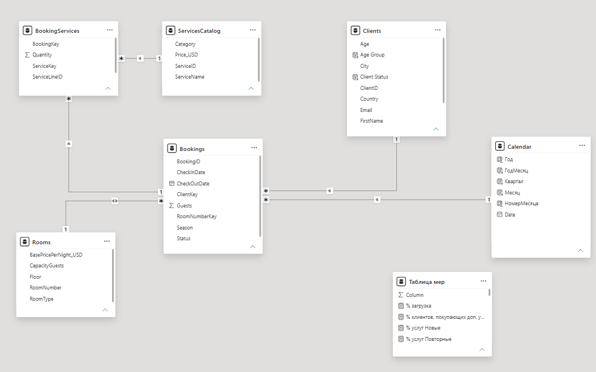
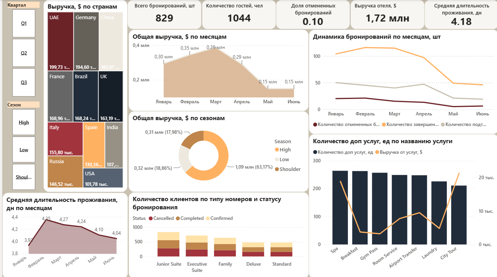
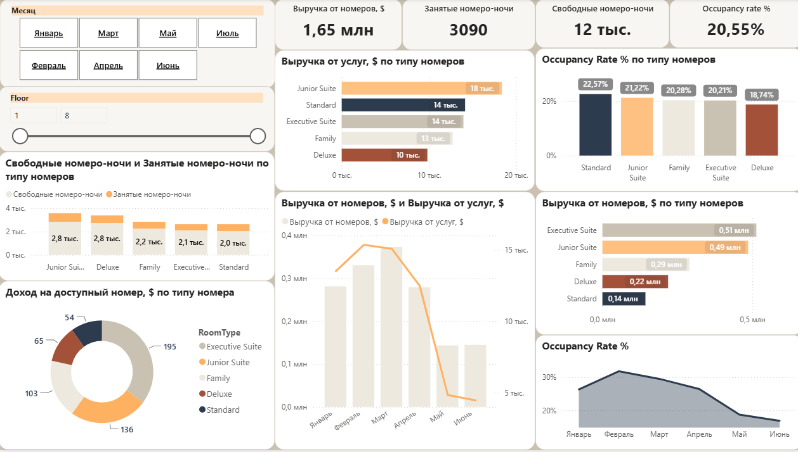
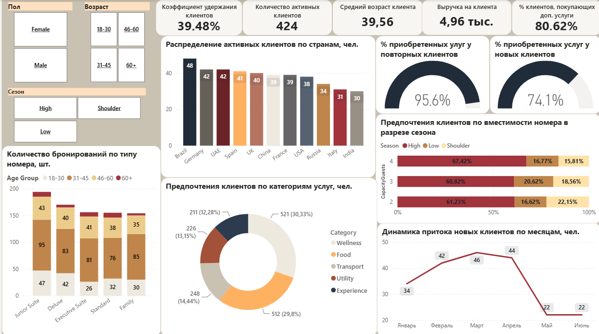
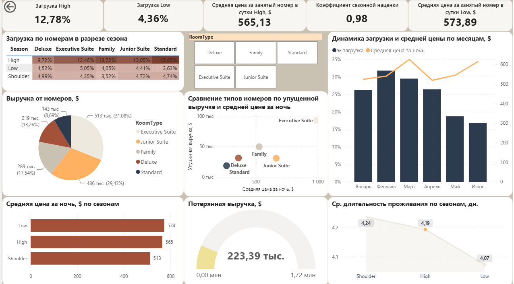

# BI-dashbords
# Hotel Performance Analysis in Power BI

Business intelligence project: an analytical dashboard for a hotel chain, built in Power BI on CRM data, with management recommendations for improving profitability.

## Overview

The goal of the project is to evaluate the operational and financial performance of a hotel chain and to identify where profitability can be improved. The report is built on CRM data and lets a manager explore results by season, room type, and client country.

**Questions the dashboard answers**

- How do bookings and revenue change across seasons? 
- Which room types and services contribute the most to revenue?
- Which client countries generate the most bookings and the highest revenue?

## Data

The data comes from the hotel chain's CRM system and covers four areas:

| Table | Content |
|---|---|
| Bookings | Reservation dates, length of stay, price, status |
| Clients | Client profile, country of origin |
| Rooms | Room type, capacity, rate |
| Services | Additional services purchased by guests |

## Data model

## Dashboard pages

### Page 1: 

### Page 2: 

### Page 3: 

### Page 4: 

## Report contents

The report uses line charts, tables, matrices, pie charts and bar charts. All pages can be filtered by:

- **Season**
- **Room type**
- **Client country**

| Page | What it shows |
|---|---|
| 1 | Booking Report |
| 2 | Report by rooms |
| 3 | Report by clients |
| 4 | Analysis of seasonality and tariff policy |

## Stack

- Power BI Desktop
- Power Query
- DAX
